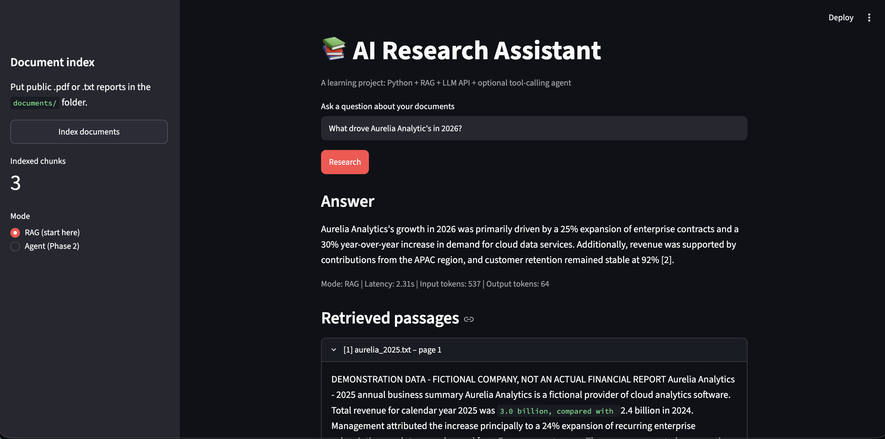
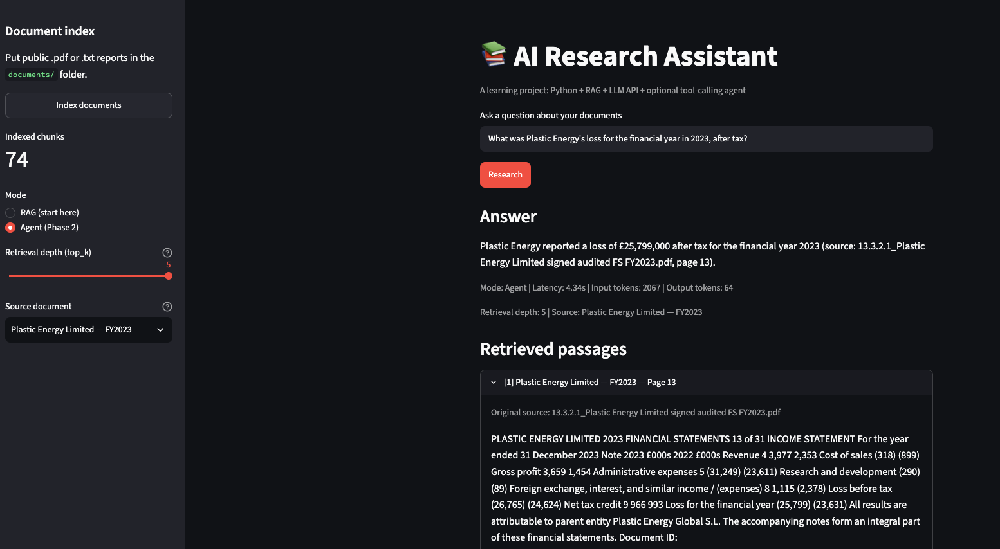

# AI Research Assistant — RAG, LLM Tool Calling & Evaluation

A Python-based research assistant that answers natural-language questions over financial research documents. It combines **Retrieval-Augmented Generation (RAG)**, **OpenAI embeddings**, **ChromaDB vector search**, and an optional **LLM tool-calling workflow**, with a lightweight **Streamlit** interface and evaluation script.

> **Project status:** Functional local learning prototype, not a production deployment. The included companies and financial data are **fictional**.


## Application Demo

<table>
  <tr>
    <th align="center">RAG Mode</th>
    <th align="center">Agent Mode</th>
  </tr>
  <tr>
    <td width="50%">
      
    </td>
    <td width="50%">
      
    </td>
  </tr>
</table>

## What it does

- **Indexes documents:** Extracts text from `.pdf` and `.txt` files, splits it into overlapping chunks, generates embeddings, and stores the text, vectors, and source metadata in a persistent local ChromaDB collection.
- **Answers with RAG:** Embeds the user's question, retrieves the top three matching chunks, and supplies them as context to an LLM. The assistant is instructed to answer from the evidence and cite its sources.
- **Supports a bounded agent mode:** An LLM formulates a query using OpenAI function calling; Python runs the `search_reports` tool and passes its results back to the LLM for a final response.
- **Records basic performance:** Reports response latency, generative-model token usage, and retrieved passages; an evaluation script measures source-level Hit@3 and heuristic abstention behaviour.

## Architecture

```text
                  ┌────────────────────────┐
                  │ Streamlit UI (app.py)   │
                  │ Index / Ask / View      │
                  └────────────┬───────────┘
                               │
              ┌────────────────┴────────────────┐
              │                                 │
       Document ingestion                  Question answering
              │                                 │
       PDF / TXT files                  ┌────────┴─────────┐
              │                        │                  │
       Text extraction               RAG mode          Agent mode
              │                        │                  │
       Overlapping chunks       Use user question    LLM generates
              │                 as search query      tool query
       OpenAI embeddings               │                  │
              │                        └────────┬─────────┘
              ▼                                 │
       Local ChromaDB ◄───────────── Embed query + vector search
       (text + vectors                       │
        + metadata)                     Retrieved passages
                                               │
                                          OpenAI LLM
                                               │
                                     Answer + source references
```

Both modes use the **same indexed documents and retrieval function**. The key difference is that basic RAG searches with the original question, whereas agent mode uses a query selected by the LLM through a structured tool call. In this prototype, the agent is **required to call one available search tool**; it is not an autonomous multi-tool system.

## V2 — Financial Statement Evaluation & Benchmarking

### Objective

Evaluate the accuracy, retrieval quality and efficiency of a financial research assistant built with OpenAI embeddings, ChromaDB and the Responses API.

V2 introduces a structured evaluation framework to benchmark RAG against an LLM tool-calling agent using 15 ground-truth questions from Plastic Energy Limited's FY2023 financial statements. The evaluation investigates retrieval quality, source filtering, response latency and token efficiency, with the aim of selecting the simplest architecture that reliably retrieves supporting evidence.

### Evaluation methodology

Created a ground-truth dataset of 15 financial research questions:

- 13 answerable questions covering financial figures, calculations and company disclosures.
- 2 unanswerable questions designed to test abstention behaviour.

Relevant document chunks were manually labelled using their source, page and chunk IDs.

Evaluated four configurations using identical questions, the same document index, source filtering and embedding model:

| Metric | RAG k=3 | RAG k=5 | Agent k=3 | Agent k=5 |
|---|---:|---:|---:|---:|
| Evidence Hit@3 | 12/13 | 12/13 | 10/13 | 11/13 |
| Evidence Hit@K | 12/13 | 13/13 | 10/13 | 13/13 |
| Mean latency | 1.95s | 2.05s | 3.79s | 3.74s |
| Mean generative LLM tokens | 1,068 | 1,646 | 1,349 | 1,951 |

### Key findings

**1. Source filtering substantially improved retrieval quality.**

Initial searches across multiple indexed companies produced irrelevant financial evidence. Restricting retrieval to the target document increased labelled Chunk Hit@3 from 46.2% to 92.3%.

**2. Retrieval depth was more beneficial than agent-based query reformulation.**

One employee-count question failed because the correct evidence ranked outside the top three chunks. Increasing retrieval depth to five recovered the relevant passage and enabled the correct answer of 92 employees.

**3. Standard RAG with k=5 was the preferred configuration.**

Both RAG and Agent mode achieved 13/13 labelled evidence hits at k=5. Standard RAG had lower average latency and lower generative LLM token consumption.

The additional LLM tool-calling step did not demonstrate sufficient benefit to justify its overhead on this dataset.

### Limitations

The benchmark contains only 15 questions and one run per configuration. Retrieval labels are manually curated, and factual answer correctness and citation faithfulness have not yet been fully scored.

Agent and RAG modes also use different answer-generation instructions, so this is a workflow comparison rather than an isolated test of query rewriting.

Token counts exclude embedding API usage. Results are not intended as production performance guarantees.

The Plastic Energy PDF is indexed locally and is not currently bundled with the repository. Reproducing the experiment requires the same source document, chunking configuration and ground-truth labels.

### Running the benchmark

Activate the project's virtual environment, index the evaluation document and run:

```
python evaluate.py --mode rag --top-k 3
python evaluate.py --mode rag --top-k 5
python evaluate.py --mode agent --top-k 3
python evaluate.py --mode agent --top-k 5
```

Each configuration generates a separate CSV containing retrieved evidence, ranking metrics, abstention behaviour, latency and token consumption.

### Future improvements

- Evaluate retrieval reranking and hybrid keyword/vector search.
- Introduce groundedness and citation-faithfulness checks.
- Add bounded iterative agent workflows for complex, multi-step financial research.
- Expand and repeat benchmarks to measure robustness and variability.


## Tech stack

| Component | Technology |
| --- | --- |
| Language | Python |
| LLM generation and tool calling | OpenAI Responses API |
| Embeddings | `text-embedding-3-small` |
| Vector database | ChromaDB (`PersistentClient`) |
| Document extraction | pypdf and Python text processing |
| User interface | Streamlit |
| Evaluation | Python, JSON test cases, CSV reporting |

The application uses the OpenAI API directly; **LangChain is not required**.

## Getting started

**Requirements:** Python **3.12 recommended** (the version used for local development), an OpenAI API key, and API billing/credits enabled for your project.

```bash
# Clone the repository
git clone https://github.com/ChrisGuti1999/ai_research_assistant.git
cd ai_research_assistant

# Create and activate a virtual environment (macOS / Linux)
python3.12 -m venv .venv
source .venv/bin/activate

# Install dependencies
python -m pip install -r requirements.txt

# Create a private local configuration file
cp .env.example .env
```

Edit `.env` and replace the placeholder key:

```dotenv
OPENAI_API_KEY=your_api_key_here
OPENAI_MODEL=gpt-4o-mini
```

Never commit `.env` or share your API key. The repository's `.gitignore` excludes `.env`, virtual environments, local ChromaDB data and generated usage logs. **Indexing and asking questions make billable OpenAI API requests.**

Launch the interface:

```bash
python -m streamlit run app.py
```

Open `http://localhost:8501`, click **Index documents**, choose **RAG** or **Agent** mode, and ask a question about the indexed material. The three included `.txt` documents are fictional examples, so you can try the application without downloading external reports.

### Example questions

- What drove Aurelia Analytics' revenue growth in 2026?
- What was Harbor Payments' processed payment volume in 2026?
- Who was Aurelia Analytics' chief executive in June 2026? *(The documents do not supply this information; the assistant should abstain.)*

## RAG versus agent: initial observations

The first local test of the same question in each mode produced the following results:

| Metric | RAG | Agent |
| --- | ---: | ---: |
| Latency | 4.37 s | 5.01 s |
| LLM input tokens | 538 | 727 |
| LLM output tokens | 61 | 159 |
| Retrieved chunks | 3 | 3 |

These are **single-run observations, not a benchmark**. Token counts cover generative LLM requests and **exclude embedding requests**; token counts are not equivalent to total monetary cost. Since the index contained only three chunks and retrieval requested the top three, both modes necessarily retrieved the entire corpus. No retrieval-quality advantage can be inferred from this comparison.

## Evaluation

Run the included evaluation script **after indexing the documents**:

```bash
python evaluate.py
```

It reads `eval_cases.json`, executes the basic RAG workflow, and saves `evaluation_results.csv`. The initial sample run returned **3/3 source-level Hit@3** on applicable questions and **1/1 expected abstention detected**.

**Important limitations:** With only three indexed chunks and `top_k=3`, the retrieval result is not a meaningful test of ranking quality. The abstention check looks for particular phrases rather than verifying semantic correctness. The script does **not** yet assess answer faithfulness, citation accuracy, repeated-run variability, or agent-mode performance. Answers require manual review.

A small chunking test is available at `tests/test_chunking.py`; to run it, install `pytest` in your environment and execute `python -m pytest`.

## Repository structure

```text
app.py                 Streamlit interface
rag.py                 Ingestion, embeddings, retrieval, generation, usage logging
agent.py               Bounded LLM function-calling workflow
evaluate.py            Basic RAG evaluation runner
eval_cases.json        Four sample evaluation questions
documents/             Fictional sample financial summaries
tests/test_chunking.py Chunking unit tests
requirements.txt       Python dependencies
.env.example           Safe configuration template
```

## Limitations and next steps

This project is designed for learning and local experimentation. It currently uses character-based chunking, has no retrieval relevance threshold or reranker, and relies on prompting rather than independent verification of generated claims. Re-indexing deletes and rebuilds the collection, so an interrupted indexing run can leave a partially populated index. Logs record user questions locally; do not use confidential or proprietary data without appropriate safeguards.

Planned improvements include:

- Expand the corpus with **publicly redistributable** research material and create a larger, labelled evaluation set.
- Compare RAG and Agent mode on retrieval quality, grounded answer correctness, abstention, latency and cost.
- Add structured output validation, robust API error handling, retries and human-review paths.
- Add automated tests, containerisation, and appropriate monitoring before exploring a controlled deployment.

## Notes

This is an **independent, AI-assisted learning project**. It does not represent work completed for an employer or client, and it has not been validated for production or high-stakes financial decision-making.
